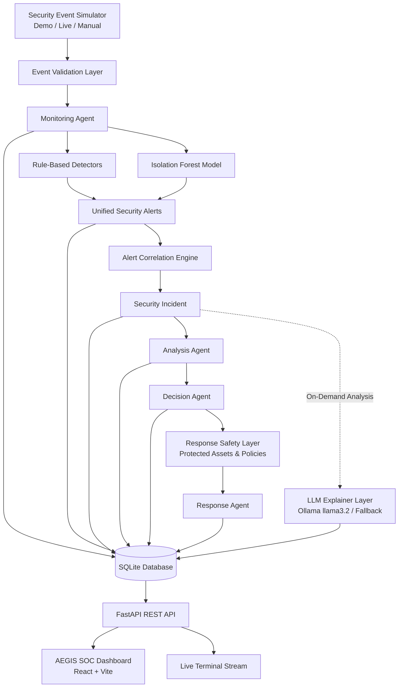

# AEGIS // AI-Powered Cyber Defense Simulator

A hybrid autonomous cybersecurity simulation platform that combines rule-based threat detection, Isolation Forest machine-learning anomaly detection, multi-agent incident analysis, response-safety controls, an on-demand **LLM Explainer Layer**, persistent SQLite storage, a FastAPI REST backend, and a real-time **Tactical SOC Operations Dashboard**.

The project generates normal and malicious security activity, detects threats, correlates related alerts into incidents, evaluates risk, selects defensive actions, performs safe simulated responses, and provides neural plain-English root-cause explanations.

> **Note:** This is an educational and research-oriented simulation. It does not modify the host Windows firewall, terminate actual operating system processes, or operate on live production network traffic.

---

## Key Features

- **Autonomous Simulation Modes:**
  - **4-Stage Demo Assault:** Automated sequence traversing normal baselining, distributed brute force, volumetric DDoS, stealth port scan, and rogue process execution.
  - **Continuous Live Telemetry Streaming:** Background thread streaming normal traffic interspersed with randomized, dynamic adversarial assaults.
  - **Tactical Threat Arsenal:** Individual direct-injection triggers for distributed brute force, volumetric DDoS, port scans, rogue process spawns, and random adversary vectors.
  - **Live Terminal Console Feed:** Monospace streaming log modal directly within the dashboard reflecting telemetry packets, detections, and defensive actions in real time.
- **Hybrid Threat Detection:**
  - Signature and threshold-based rule detection.
  - Unsupervised machine learning via Isolation Forest trained on baseline behavior.
  - Unified alert normalization and multi-source alert correlation.
- **Multi-Agent Architecture:**
  - Specialized agents for monitoring, analysis, decision-making, and containment.
  - **LLM Explainer Layer:** On-demand neural incident advisor powered by local Ollama (`llama3.2`) with an offline deterministic fallback engine.
- **Response Safety & Governance:**
  - Protected entities (domain controllers, gateways, critical assets).
  - Risk and confidence thresholds with duplicate-action suppression.
  - Approval workflows, action cooldowns, and full audit trail.
- **AEGIS SOC Tactical Dashboard:**
  - Modern Stealth Military SOC design system (titanium obsidian, electric emerald, tactical amber, threat crimson).
  - Real-time Zulu (UTC) operations clock and dynamic DEFCON threat status badge.
  - Classified Threat Dossier slide-over with severity-coded glowing borders.
  - Floating Tactical Toast Notification HUD.

---

## Supported Security Scenarios

| Scenario | Rule-Based Detection | ML Anomaly Detection | Autonomous Mitigation |
|---|:---:|:---:|---|
| **Brute-Force Login** | Yes | Possible | Block source IP address |
| **Distributed Brute Force** | Yes | Yes | Block confirmed attacker IPs |
| **DDoS Request Flood** | Yes | Yes | Rate-limit confirmed attacker IPs |
| **Stealth Port Scan** | Yes | Possible | Block scanner IP address |
| **Suspicious Process Activity** | Yes | Possible | Quarantine malicious process |
| **Low-and-Slow Credential Attack** | No | Yes | Flag for manual SOC investigation |
| **Distributed Endpoint Flood** | No | Yes | Flag for manual SOC investigation |
| **Zero-Day / Novel Anomalies** | No fixed signature | Yes | Escalate anomaly window for triage |

Rule-based detection provides zero-latency precision for known signatures. Isolation Forest identifies behavioral deviations that remain below fixed threshold limits.

---

## System Architecture



---

## Multi-Agent Workflow

The system coordinates defense through specialized autonomous software agents:

1. **Monitoring Agent:** Ingests validated event telemetry and fans out evaluation across rule engines and the Isolation Forest ML pipeline.
2. **Analysis Agent:** Correlates alerts sharing common sources, entities, or temporal windows into unified security incidents, assessing severity, risk scores, and confidence metrics.
3. **Decision Agent:** Determines the optimal containment strategy against configured security policies.
4. **Response Agent:** Enforces policy checks, verifies entity protection rules (e.g., safeguarding critical infrastructure from accidental isolation), and executes simulated mitigations.
5. **Coordinator:** Orchestrates message passing, state progression, and database synchronization.
6. **LLM Explainer Agent (`LLMExplainer`):** An on-demand intelligence agent that interfaces with local LLMs (Ollama `llama3.2`) via structured JSON schema inference. It translates telemetry signals, anomaly scores, and agent decisions into executive summaries, root cause explanations, and actionable defensive playbooks. If Ollama is offline, it seamlessly falls back to a deterministic local template engine with zero downtime.

---

## Detection & Response Evaluation Benchmarks

In a controlled benchmark across 700 telemetry windows evaluating normal activity, signature attacks, and low-and-slow threshold-evasion assaults:

### Detection Performance

| Detection Method | Accuracy | Precision | Detection Rate | False Positive Rate | F1 Score |
|---|---:|---:|---:|---:|---:|
| **Rule-Based Engine** | 71.4% | 100.0% | 66.7% | 0.0% | 80.0% |
| **Isolation Forest (ML)** | 75.6% | 99.5% | 71.8% | 2.0% | 83.4% |
| **Hybrid Pipeline** | **99.7%** | **99.7%** | **100.0%** | **2.0%** | **99.8%** |

### Response Pipeline Metrics

| Evaluation Metric | Benchmark Result |
|---|---:|
| **Attack Response Coverage** | **100.0%** |
| **Correct Workflow Transition Rate** | **100.0%** |
| **Unsafe Normal Containment Rate** | **0.0%** |
| **Average Pipeline Processing Latency** | **30.4 ms** |

---

## Technology Stack

- **Backend & Simulation:** Python 3.11+, FastAPI, Uvicorn, Pydantic, SQLite
- **Machine Learning:** scikit-learn (Isolation Forest), NumPy, SciPy, Joblib
- **AI & LLM Integration:** Ollama (`llama3.2`), `httpx` asynchronous client, structured JSON schema prompting, local deterministic fallback engine
- **Frontend Dashboard:** React 18, Vite, Vanilla CSS Design System (Stealth Military SOC Theme), JetBrains Mono & Chakra Petch typography
- **Quality & Testing:** Python `unittest`, ESLint, Vitest, React Testing Library

---

## Project Structure

```text
AI-Cyber-Defense-Simulator/
├── agents/             Autonomous agents (Coordinator, Monitoring, Analysis, Decision, Response, LLM Explainer)
├── alerting/           Alert schemas, normalization, and incident correlation
├── backend/            FastAPI application, route handlers, and simulation controller
├── config/             Central configuration (security_config.json) & settings parser
├── dashboard/          React + Vite SOC web application
│   ├── src/
│   │   ├── api.js      REST client & simulation API bindings
│   │   ├── App.jsx     Main SOC layout, battle stations, threat dossier, terminal modal
│   │   └── App.css     Stealth Military SOC design system
├── data/               Generated event logs and SQLite database (security_defense.db)
├── detector/           Rule-based signatures and Isolation Forest model training
├── docs/               Detailed architecture and technical documentation
├── evaluation/         Detection and mitigation benchmarking suite
├── models/             Trained machine learning models (isolation_forest.joblib)
├── monitor/            Strict schema validation for incoming event telemetry
├── simulator/          Normal traffic and attack scenario generator engines
├── storage/            SQLite schema, migrations, and database queries
├── tests/              Unit and integration test suites
├── requirements.txt    Python dependencies
└── README.md
```

---

## Quickstart Guide

### 1. Prerequisites

- Python 3.11+
- Node.js 18+ and npm
- *(Optional, for LLM layer)* [Ollama](https://ollama.com/) with `llama3.2`:
  ```bash
  ollama pull llama3.2
  ```

### 2. Environment Setup

Clone the repository and activate a Python virtual environment:

```powershell
git clone https://github.com/vasanthvaka/AI-Cyber-Defense-Simulator.git
cd "AI-Cyber-Defense-Simulator"

python -m venv venv
.\venv\Scripts\Activate.ps1
python -m pip install -r requirements.txt
```

Install frontend dependencies:

```powershell
cd dashboard
npm install
cd ..
```

### 3. Generate Training Data & Train Anomaly Model

```powershell
# 1. Generate normal baseline telemetry
python -m simulator.generate_training_data

# 2. Train the Isolation Forest model
python -m detector.train_anomaly_model
```
The trained model will be saved to `models/isolation_forest.joblib`.

---

## Running the Platform

### Option A: Launch via Web Dashboard (Recommended)

1. **Start the FastAPI Backend:**
   ```powershell
   & ".\venv\Scripts\python.exe" -m uvicorn backend.api:app --reload --port 8000
   ```
   * Swagger Docs: [http://127.0.0.1:8000/docs](http://127.0.0.1:8000/docs)

2. **Start the React SOC Dashboard:**
   ```powershell
   cd dashboard
   npm run dev
   ```
   * Open [http://localhost:5173](http://localhost:5173) in your browser.

3. **Interact from the Web Console:**
   - **Launch Demo Scenario 🚀:** Triggers an automated 4-stage sequential attack lifecycle.
   - **Engage Live Stream ⚡:** Runs continuous background telemetry with live event & attack counters.
   - **Terminal Feed 📟:** Opens a real-time monospace terminal log modal streaming live events.
   - **Threat Arsenal Cards:** Directly launch individual attack vectors (Brute Force, DDoS, Port Scan, Rogue Process, Random Adversary).
   - **Explain with AI ✨:** Click on any incident row to open the classified Threat Dossier, then trigger plain-English neural root-cause analysis.

### Option B: Run via CLI

Run the simulator directly from the terminal without launching the web server:

```powershell
# Demo Mode (Presentation order, reproducible with seed)
python -m simulator.main --mode demo --seed 42

# Live Mode (Continuous stream, stop with Ctrl+C)
python -m simulator.main --mode live --seed 99
```

---

## Running Automated Tests & Quality Checks

### Python Test Suite
```powershell
python -m unittest discover tests
```

### Frontend Linting & Unit Tests
```powershell
cd dashboard
npm run lint
npm test -- --run
```

### Run Scientific Benchmark Evaluators
```powershell
# Detection fidelity benchmark
python -m evaluation.system_evaluator

# Response pipeline & safety governance benchmark
python -m evaluation.response_evaluator
```
Generated reports are stored under `evaluation/results/`.

---

## REST API Reference

| Method | Endpoint | Description |
|---|---|---|
| `GET` | `/api/dashboard` | Aggregated statistics, events, alerts, incidents, responses, and audit logs |
| `POST` | `/api/simulation/demo` | Execute synchronous 4-stage demonstration with optional random seed |
| `POST` | `/api/simulation/live/start` | Launch continuous background telemetry streaming thread |
| `POST` | `/api/simulation/live/stop` | Terminate active live background streaming |
| `GET` | `/api/simulation/live/log` | Fetch sliding-window live terminal log entries and real-time counters |
| `POST` | `/api/simulation/attack/{attack_type}` | Ingest a targeted attack scenario (`brute-force`, `ddos`, `port-scan`, `suspicious-process`) |
| `POST` | `/api/simulation/random-attack` | Ingest a randomly selected adversarial scenario |
| `POST` | `/api/simulation/normal` | Ingest a batch of normal baseline traffic events |
| `GET` | `/api/incidents/{incident_id}` | Retrieve comprehensive incident dossier by ID |
| `POST` | `/api/incidents/{incident_id}/explain` | Request on-demand plain-English LLM root cause analysis |

---

## Configuration & Tuning

All security thresholds, detection windows, and simulation parameters are centralized in:

```text
config/security_config.json
```

Key configuration sections:
- `rules`: Thresholds for login failures, port sweep counts, DDoS request rates, and process execution criteria.
- `ai`: Window size, contamination rate, and feature extractor parameters.
- `llm`: Provider configuration (Ollama model `llama3.2`, endpoint URL, timeout).
- `safety`: Protected IP addresses, containment confidence thresholds, and human-approval gates.
- `simulation`: Delay intervals, normal traffic volume ranges, and live-mode attack probability.

---

## Safety & Governance Philosophy

1. **Separation of Evidence and Response Targets:** IP addresses identified inside anomalous ML windows are retained as investigative evidence but are not automatically blocked unless corroborated by deterministic rule matches or confidence thresholds.
2. **Protected Entity Safeguards:** Critical IP ranges (e.g., DNS servers, default gateways, Active Directory Domain Controllers) cannot be blocked by automated policies.
3. **Auditability:** Every containment decision produces an immutable audit trail entry detailing policy checks, rationale, and timestamp.
4. **Resilience & Fallback:** The LLM Explainer layer operates completely out-of-band on request. Simulation performance and autonomous containment are never delayed or bottlenecked by LLM latency.

---

## License

This project is licensed under the MIT License — see the [LICENSE](LICENSE) file for details.
