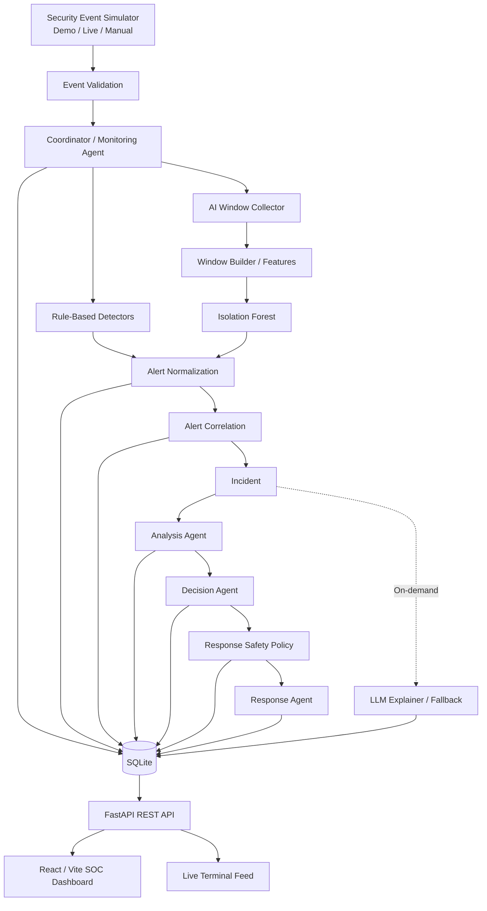

# AEGIS — AI-Powered Cyber Defense Simulator

<p align="center">
  <strong>A hybrid, autonomous cyber-defense simulation platform</strong>
</p>

AEGIS is a cybersecurity simulation and monitoring platform that brings together **synthetic telemetry generation, rule-based threat detection, machine-learning anomaly detection, alert correlation, multi-agent incident analysis, response governance, local LLM explanations, persistent storage, a REST API, and a tactical SOC dashboard**.

The simulator creates normal and malicious activity, validates events, analyzes them through independent detection paths, correlates alerts into incidents, assesses risk, chooses defensive actions, applies response-safety policies, and records simulated response outcomes. The dashboard provides an interactive view of the simulation and the security workflow.

> **Safety / scope:** AEGIS is intended for education, research, demonstrations, and controlled experiments. It uses synthetic activity and records defensive actions as simulations. It does not modify the host firewall, terminate real operating-system processes, or monitor live production traffic.

---

## Contents

- [Project Goals](#project-goals)
- [Features](#features)
- [Supported Scenarios](#supported-scenarios)
- [Architecture](#architecture)
- [Event-to-Incident Pipeline](#event-to-incident-pipeline)
- [Detection System](#detection-system)
- [Alert Correlation and Incidents](#alert-correlation-and-incidents)
- [Multi-Agent Workflow](#multi-agent-workflow)
- [Response Safety and Governance](#response-safety-and-governance)
- [LLM Explainer Layer](#llm-explainer-layer)
- [Tactical SOC Dashboard](#tactical-soc-dashboard)
- [Technology Stack](#technology-stack)
- [Repository Structure](#repository-structure)
- [Prerequisites](#prerequisites)
- [Installation](#installation)
- [Run AEGIS](#run-aegis)
- [Dashboard Demonstration](#dashboard-demonstration)
- [REST API](#rest-api)
- [Machine-Learning Training](#machine-learning-training)
- [Evaluation and Benchmarks](#evaluation-and-benchmarks)
- [Configuration](#configuration)
- [Storage and Generated Artifacts](#storage-and-generated-artifacts)
- [Tests and Quality Checks](#tests-and-quality-checks)
- [Troubleshooting](#troubleshooting)
- [Limitations](#limitations)

---

## Project Goals

AEGIS is built to demonstrate how a security operations workflow can connect detection, investigation, decision-making, and response while retaining safeguards around potentially disruptive actions.

The project explores:

- Combining explainable signatures and thresholds with unsupervised anomaly detection.
- Transforming raw security events into standardized alerts and incidents.
- Coordinating specialized agents through a structured message flow.
- Using incident evidence, confidence, and risk to select response actions.
- Protecting critical entities and requiring approval for higher-impact containment.
- Keeping optional LLM-generated explanations separate from the core detection/response pipeline.
- Evaluating detection quality and response workflow behavior through repeatable synthetic scenarios.

## Features

### Simulation
- **Demo mode:** A repeatable staged run that includes normal activity and attack scenarios.
- **Live mode:** A continuous stream of synthetic activity, with attacks introduced probabilistically.
- **Manual attack injection:** Trigger individual scenario types from the API/dashboard.
- **Random attack injection:** Let the simulator choose a supported attack.
- **Reproducible runs:** Optional random seed for repeatable demo and experiment runs.
- **Configurable telemetry:** Normal-event volume, attack intensity, source diversity, timing, and live-mode probabilities.

### Detection and incident workflow
- Rule/signature and threshold-based detectors.
- Unsupervised Isolation Forest anomaly detection trained on baseline windows.
- Separate rule and ML paths with unified alert normalization.
- Multi-source alert correlation into incidents.
- Incident severity, confidence, risk/evidence context, and linked records.

### Agent-based analysis and response
- Monitoring, analysis, decision, and response agents.
- Central coordinator for message passing and workflow progression.
- Structured schemas for agent messages and analysis records.
- Response policy and safety checks.
- Protected-entity safeguards, approval workflows, action cooldowns, and duplicate suppression.
- Audit records for response-policy decisions and outcomes.

### LLM incident explanation
- On-demand local Ollama integration (configured for `llama3.2`).
- Structured incident explanation output.
- Deterministic offline fallback when the local model cannot be used.
- Explanation requests are out-of-band; detection and response are not dependent on LLM availability.

### Dashboard and API
- AEGIS Tactical SOC operations interface.
- Overview statistics and activity data.
- Incident list and incident detail/dossier.
- Simulation controls for normal activity, attack injection, demo, and live mode.
- Live terminal/log feed with simulation counters.
- REST API with Swagger/OpenAPI documentation.
- SQLite persistence for security records and evaluation output files.

---

## Supported Scenarios

| Scenario | Rule-based detection | ML anomaly detection | Example simulated response |
|---|:---:|---:|---|
| Brute-force login | Yes | Possible | Block source IP |
| Distributed brute force | Yes | Yes | Block confirmed attacker IPs (may require approval) |
| DDoS/request flood | Yes | Yes | Rate-limit attacker sources |
| Port scan | Yes | Possible | Block scanner IP |
| Suspicious process activity | Yes | Possible | Quarantine simulated process |
| Low-and-slow credential attack | Not by fixed signature | Yes | Flag for SOC investigation |
| Distributed endpoint flood | Not by fixed signature | Yes | Flag for SOC investigation |
| Novel/zero-day-like anomaly | No fixed signature | Yes, if behavior is anomalous | Escalate for triage |

Rule-based detection targets known patterns. Isolation Forest analyzes behavioral windows and can flag activity that does not match a specific signature. An anomaly is evidence of unusual behavior—not a definitive attack classification.

---

## Architecture



### Main components

| Component | Responsibility |
|---|---|
| `simulator/` | Generates normal events, attack scenarios, demo sequences, and live activity. |
| `monitor/` | Validates events, processes telemetry, and collects time windows for ML analysis. |
| `detector/` | Rule detectors, feature extraction, window construction, model training, and anomaly evaluation. |
| `alerting/` | Alert schema, normalization, correlation, and incident creation. |
| `agents/` | Agent base, coordinator, monitoring, analysis, decision, response, and LLM explanation. |
| `storage/` | SQLite schema, queries, persistence, and database operations. |
| `backend/` | FastAPI routes and simulation controller for API-driven runs. |
| `dashboard/` | React SOC interface and API client. |
| `evaluation/` | Detection and response evaluation scripts, metrics, and saved results. |
| `config/` | Configuration loading, validation, and central security settings. |


## Event-to-Incident Pipeline

1. **Generate telemetry:** The scenario engine creates normal or attack events (login, HTTP, network, process activity).
2. **Validate:** The event validator checks the event structure and field values before processing.
3. **Monitor:** The Monitoring Agent receives validated events and routes them into the detection paths.
4. **Detect:** Rule detectors evaluate known patterns; the AI window collector aggregates events for ML analysis.
5. **Normalize:** Detector results are converted to a shared alert schema.
6. **Correlate:** Related alerts are grouped into incidents based on common context and time relationships.
7. **Analyze:** The Analysis Agent evaluates incident evidence, severity, confidence, and risk.
8. **Decide:** The Decision Agent selects an action appropriate to the incident.
9. **Apply safety policy:** The response policy evaluates protected entities, confidence/risk gates, approval requirements, cooldowns, and duplicate actions.
10. **Simulate response:** The Response Agent records the simulated action and result.
11. **Persist:** Events, alerts, incidents, analysis, decisions, responses, and audit data are stored in SQLite and exposed through the API/dashboard.
12. **Explain (on demand):** The optional LLM Explainer produces a plain-language incident explanation using incident context and related analysis/decision records.

## Detection System

### Rule-based detectors

Rule-based detectors operate on event-level and aggregated activity using configurable thresholds and time windows.

| Detector | Description |
|---|---|
| Brute-force detector | Identifies repeated failed login attempts from a source within a configured interval. |
| Distributed brute-force logic | Detects multiple source IPs attempting credentials against a shared account/context. |
| DDoS detector | Detects elevated HTTP request volume and source diversity against a service or endpoint. |
| Port-scan detector | Detects one source probing many destination ports within a time window. |
| Suspicious-process detector | Assigns risk based on process characteristics, including suspicious parent processes, executable paths, and command-line indicators. |

Rule detections are intended to be relatively direct and interpretable for known behaviors. They can miss activity that remains below thresholds or changes its pattern.

### Isolation Forest anomaly detection

The ML detector uses **scikit-learn Isolation Forest**, an unsupervised model trained on generated baseline/normal event windows. At runtime, events are aggregated into windows and converted into features for anomaly scoring.

Feature families include:

- Event counts and event-type counts.
- Login attempts and failed logins.
- Unique source IP counts.
- HTTP request volume and endpoint diversity.
- Network connection activity and destination-port diversity.
- Process event counts and process-name diversity.
- Per-user failed-login maxima.
- Per-source, per-service, or per-endpoint request maxima.
- Per-source port diversity.
- Command-line length characteristics.

The model may emit an `ANOMALOUS_BEHAVIOR` alert for unusual windows. It does not inherently know the exact attack label, so its output is used as anomaly evidence rather than a guaranteed classification.

### Hybrid detection

The two paths are complementary:

- **Rule path:** Identifies recognizable, threshold-defined behaviors.
- **ML path:** Identifies event windows that differ from the baseline distribution.
- **Combined pipeline:** Normalizes and correlates their evidence into incidents.

This combination is intended to balance interpretable detection of known patterns with detection of behavior that may evade fixed thresholds.

---

## Alert Correlation and Incidents

Each detector may produce an alert in its own format. The normalization layer maps results into a shared alert structure, including common fields such as identifiers, timestamps, attack/detection types, sources, targets, severity, confidence, evidence, related event IDs, status, and optional anomaly scores.

The correlator uses relationships between alerts and their context to group supporting signals into incidents. Incidents provide a unified object for downstream analysis, decisions, responses, API retrieval, and dashboard presentation.

The dashboard/API can expose individual event, alert, and incident records as well as their related analysis and response workflow records.

---

## Multi-Agent Workflow

AEGIS uses specialized software agents with structured messages and a coordinator that manages workflow and persistence.

| Agent / module | Role |
|---|---|
| **Monitoring Agent** | Accepts validated events, invokes rule detectors, and contributes events to ML windows. |
| **Analysis Agent** | Evaluates incident evidence and produces structured analysis, severity, confidence, and risk-related findings. |
| **Decision Agent** | Selects a defensive action using the incident and analysis context. |
| **Response Agent** | Handles the response stage and records the simulated result. |
| **Coordinator** | Orchestrates messages, workflow state, agent interactions, and database synchronization. |
| **LLM Explainer (`LLMExplainer`)** | On-demand explanation agent that summarizes evidence and decisions into human-readable incident context. |


## Response Safety and Governance

Response selection is separate from response execution. The response safety layer exists to prevent potentially unsafe containment decisions from being blindly simulated as automatic actions.

Safety concepts implemented in the project include:

- **Protected entities:** Critical infrastructure addresses/entities can be protected from containment, including examples such as domain controllers, gateways, and critical assets.
- **Confidence and risk gates:** Response decisions are checked against configured criteria.
- **Human approval:** Higher-impact actions can be marked approval-required rather than automatically executed.
- **Cooldowns:** Actions can be limited to prevent excessive repetition.
- **Duplicate suppression:** Repeated containment for the same incident/action can be suppressed.
- **Audit trail:** Policy decisions and response outcomes are persisted for later inspection.
- **ML evidence separation:** IPs surfaced in anomalous windows are investigative evidence; they are not automatically blocked unless supported by policy and corroborating rule/confidence criteria.

All actions are simulated. The response layer does not install firewall rules, modify Windows Defender Firewall, kill operating-system processes, or quarantine actual files/processes.

---

## LLM Explainer Layer

The LLM Explainer is an **on-demand enrichment feature**. It is separate from the critical detection and response path.

### Configured local setup

| Setting | Default |
|---|---|
| Provider | `ollama` |
| Model | `llama3.2` |
| Local API endpoint | `http://127.0.0.1:11434` |
| Request timeout | `30` seconds |

The explainer sends incident context, related analysis, and decision information to the configured local model and requests structured explanation content. It can provide an executive summary, root-cause narrative, supporting signals, response rationale, and recommended defensive considerations.

If Ollama is unavailable, times out, or produces unusable output, AEGIS uses a deterministic fallback explanation. The fallback keeps the feature usable without requiring an LLM service. LLM output should be treated as advisory and reviewed rather than as authoritative security guidance.

To prepare Ollama (optional):

```bash
# Install Ollama from https://ollama.com/ first, then pull the configured model:
ollama pull llama3.2
```

## Tactical SOC Dashboard

The frontend is a React application built with Vite. Its visual design is inspired by a tactical Security Operations Center (SOC): dark/stealth surfaces, high-contrast status colors, compact telemetry, severity-oriented incident presentation, and monospace terminal-style elements.

Dashboard capabilities described by the code/project include:

- **Operations overview:** Statistics/counts for security records.
- **Incident list:** Browse detected incidents and open an incident dossier/detail view.
- **Threat Dossier:** Inspect incident information and request on-demand explanation.
- **Simulation controls:** Generate normal activity, trigger an attack, inject a random attack, run the demo, or start/stop live mode.
- **Live terminal modal/feed:** View live simulator log entries and counters for events/attacks.
- **Tactical notifications:** Toast-style HUD notifications for activity and feedback.
- **API-backed data:** Events, alerts, incidents, analyses, decisions, responses, and audit records are fetched from the backend.


## Technology Stack

### Backend, simulation, and storage
- Python 3.11+
- FastAPI
- Uvicorn
- Pydantic
- SQLite (`sqlite3`)
- `scikit-learn` — Isolation Forest
- `NumPy` / `SciPy` — scientific computing dependencies
- `joblib` — model serialization
- `httpx` — local LLM API client

### Frontend
- React 19
- Vite
- JavaScript / JSX
- CSS
- ESLint
- Vitest
- React Testing Library
- jsdom

### AI / local inference
- Ollama
- `llama3.2` (configured default model)
- JSON-structured output prompting and deterministic local fallback

---

## Repository Structure


```text
AI-Cyber-Defense-Simulator/
├── agents/                         # Agent classes, coordinator, schemas, LLM explainer
│   ├── base_agent.py
│   ├── coordinator.py
│   ├── monitoring_agent.py
│   ├── analysis_agent.py
│   ├── analysis_schema.py
│   ├── decision_agent.py
│   ├── response_agent.py
│   ├── response_policy.py
│   ├── message_schema.py
│   └── llm_explainer.py
├── alerting/                       # Alert schemas, normalization, correlation, incidents
├── backend/                         # FastAPI application and simulation controller
├── config/                           # Settings loader and security configuration
├── data/                              # Local generated data/database (created/used at runtime)
├── detector/                          # Rule detectors, ML feature/window/model pipeline
├── evaluation/                         # Detection and response evaluation tools/results
├── models/                              # Trained Isolation Forest artifact
├── monitor/                              # Event validation, processing, AI window collector
├── simulator/                            # Synthetic events, attack scenarios, CLI, data generation
├── storage/                              # SQLite persistence layer
├── dashboard/                             # React + Vite tactical SOC frontend
│   ├── src/
│   │   ├── App.jsx
│   │   ├── App.css
│   │   ├── api.js
│   │   └── ...
│   ├── public/
│   └── package.json
├── docs/
│   ├── architecture.md                    # Pipeline architecture notes
│   └── demo_guide.md                     # Demonstration walkthrough
├── tests/                                 # Python unit and integration tests
├── requirements.txt                       # Python dependencies
└── README.md
```


## Prerequisites

- Python **3.11 or newer** recommended.
- Node.js **18+** and npm.
- Windows PowerShell for the commands in the examples (macOS/Linux equivalents are included for virtual-environment activation).
- Optional: Ollama and the `llama3.2` model for locally generated incident explanations.

## Installation

### 1. Clone the repository

```powershell
git clone https://github.com/vasanthvaka/AI-Cyber-Defense-Simulator.git
cd AI-Cyber-Defense-Simulator
```

### 2. Create and activate a virtual environment

```powershell
python -m venv venv
.\venv\Scripts\Activate.ps1
```

On macOS/Linux:

```bash
python3 -m venv venv
source venv/bin/activate
```

### 3. Install Python dependencies

Install the pinned dependencies from `requirements.txt` into the active virtual environment:

```powershell
python -m pip install -r requirements.txt
```

### 4. Install dashboard packages

```powershell
cd dashboard
npm install
cd ..
```

### 5. Generate normal training data and train the anomaly model

The model artifact is expected at `models/isolation_forest.joblib`. If the trained artifact is not present or you want to retrain it:


```powershell
python -m simulator.generate_training_data
python -m detector.train_anomaly_model
```

---

## Run AEGIS

Start the backend and frontend in separate terminals. Use the project root for backend commands so Python package imports resolve correctly.


### Option 1 — Web Dashboard (recommended)

**Terminal 1 — Backend API:**

```powershell
python -m uvicorn backend.api:app --reload --port 8000
```

API base address: `http://127.0.0.1:8000`

Interactive Swagger documentation: `http://127.0.0.1:8000/docs`

**Terminal 2 — Dashboard:**

```powershell
cd dashboard
npm run dev
```

Open the Vite URL (typically `http://127.0.0.1:5173`).

The frontend uses `VITE_API_URL` if defined; otherwise its API base defaults to `http://127.0.0.1:8000`.

### Option 2 — Command-line simulation

Run from the repository root:


```powershell
# Repeatable staged demonstration
python -m simulator.main --mode demo --seed 42

# Continuous synthetic traffic with randomized attacks (stop with Ctrl+C)
python -m simulator.main --mode live --seed 99
```

CLI options:

| Option | Description |
|---|---|
| `--mode` | `demo` or `live`; defaults to `demo`. |
| `--seed` | Optional integer seed to reproduce randomized activity. Demo defaults to seed 42 if no seed is supplied. |

The CLI demonstration sequence includes normal activity interspersed with distributed brute force, DDoS, port scan, and suspicious-process activity. Live mode generates normal batches and occasionally injects a random attack based on configuration.

---

## Dashboard Demonstration

A suggested presentation flow:


1. Start the backend API and dashboard using the steps above.
2. Open the dashboard and show the current overview/statistics.
3. Use the **Demo** control to trigger the staged attack sequence.
4. Observe alerts/incidents appear and open an incident row/dossier to inspect details.
5. Trigger the **Explain with AI** action for an incident to show the on-demand explainer and fallback behavior if Ollama is unavailable.
6. Use the individual attack controls to demonstrate one scenario at a time.
7. Start live simulation and observe the counters and live console feed.
8. Stop live simulation when finished.
9. Reset simulation data before a fresh demonstration if desired.

For a step-by-step presentation script and expected results, see [`docs/demo_guide.md`](docs/demo_guide.md).

---

## REST API

FastAPI routes are available at `http://127.0.0.1:8000`. Interactive schema and try-it-out functionality are available at `/docs`; this is the best place to verify current request payloads and response schemas.


### Simulation controls

| Method | Endpoint | Description |
|---|---|---|
| `GET` | `/api/simulation/status` | Read simulation controller status. |
| `POST` | `/api/simulation/normal` | Generate a normal traffic batch; request body supports `count`. |
| `POST` | `/api/simulation/attacks/random` | Inject a randomly selected attack. |
| `POST` | `/api/simulation/attacks/{attack_type}` | Inject a supported attack (`brute-force`, `ddos`, `port-scan`, `suspicious-process`). |
| `POST` | `/api/simulation/demo` | Run the demo; optional `seed` supports reproducibility. |
| `POST` | `/api/simulation/live/start` | Start continuous live simulation; optional seed/random-seed behavior. |
| `POST` | `/api/simulation/live/stop` | Stop live simulation. |
| `GET` | `/api/simulation/live/log` | Retrieve recent live log entries and counters. |
| `POST` | `/api/simulation/reset` | Reset simulator data stored by the backend. |

### Security-data endpoints

| Method | Endpoint | Description |
|---|---|---|
| `GET` | `/` | API identity and links to docs/health. |
| `GET` | `/api/health` | Health and database connection summary. |
| `GET` | `/api/statistics` | Counts of stored event and workflow records. |
| `GET` | `/api/events` | List events. |
| `GET` | `/api/events/{event_id}` | Fetch one event by ID. |
| `GET` | `/api/alerts` | List alerts. |
| `GET` | `/api/alerts/{alert_id}` | Fetch one alert by ID. |
| `GET` | `/api/incidents` | List incidents. |
| `GET` | `/api/incidents/{incident_id}` | Fetch incident dossier data by ID. |
| `POST` | `/api/incidents/{incident_id}/explain` | Request an LLM/fallback explanation for an incident. |
| `GET` | `/api/analyses` | List analysis records. |
| `GET` | `/api/analyses/{analysis_id}` | Fetch one analysis by ID. |
| `GET` | `/api/decisions` | List decision records. |
| `GET` | `/api/decisions/{decision_id}` | Fetch one decision by ID. |
| `GET` | `/api/responses` | List simulated response records. |
| `GET` | `/api/responses/{response_id}` | Fetch one response by ID. |
| `GET` | `/api/audit-records` | List audit records. |
| `GET` | `/api/audit-records/{audit_id}` | Fetch one audit record by ID. |

The record-list endpoints accept a `limit` query parameter (default `100`, maximum `500`). For example:

```text
GET /api/events?limit=50
GET /api/incidents?limit=25
```

### Example API calls

**Generate normal activity:**

```bash
curl -X POST http://127.0.0.1:8000/api/simulation/normal \
  -H "Content-Type: application/json" \
  -d '{"count":10}'
```

**Run the demo:**

```bash
curl -X POST http://127.0.0.1:8000/api/simulation/demo \
  -H "Content-Type: application/json" \
  -d '{"seed":42}'
```

**Inject a DDoS scenario:**

```bash
curl -X POST http://127.0.0.1:8000/api/simulation/attacks/ddos
```

**Get current simulation status:**

```bash
curl http://127.0.0.1:8000/api/simulation/status
```

---

## Machine-Learning Training

### 1. Generate baseline data

```bash
python -m simulator.generate_training_data
```

The generator creates synthetic normal activity for the model-training workflow.

### 2. Train Isolation Forest

```bash
python -m detector.train_anomaly_model
```

Training constructs time windows and features from the baseline data and trains the Isolation Forest anomaly model. The serialized model is written to:


```text
models/isolation_forest.joblib
```

### 3. Evaluate the anomaly model

```bash
python -m detector.evaluate_anomaly_model
```

The evaluation script assesses anomaly detection behavior using the project's generated datasets/windows and supported evaluation logic. Refer to the evaluator's output for the metrics of that run.

---

## Evaluation and Benchmarks

The repository includes evaluation tools for the hybrid detection system and the response workflow:


```bash
# Detection/system evaluation
python -m evaluation.system_evaluator

# Response policy and action workflow evaluation
python -m evaluation.response_evaluator
```

Generated evaluation reports are saved in `evaluation/results/`.

### Benchmark snapshot documented in the previous README

The previous project README reported a controlled benchmark over **700 telemetry windows**. These values are retained here as a previously documented result snapshot—not a promise that the current code, environment, or a fresh run will reproduce the same metrics.

#### Detection performance

| Detection method | Accuracy | Precision | Detection rate | False-positive rate | F1 score |
|---|---:|---:|---:|---:|---:|
| Rule-based engine | 71.4% | 100.0% | 66.7% | 0.0% | 80.0% |
| Isolation Forest (ML) | 75.6% | 99.5% | 71.8% | 2.0% | 83.4% |
| **Hybrid pipeline** | **99.7%** | **99.7%** | **100.0%** | **2.0%** | **99.8%** |

#### Response pipeline metrics

| Metric | Previously reported result |
|---|---:|
| Attack response coverage | 100.0% |
| Correct workflow transition rate | 100.0% |
| Unsafe normal containment rate | 0.0% |
| Average pipeline processing latency | 30.4 ms |


To validate these numbers, run the evaluators locally and use the new output files as the results for the current build. Metrics depend on the synthetic data, configuration, seed, model artifact, and code version.

---

## Configuration

Settings are centralized in:


```text
config/security_config.json
```

`config/settings.py` loads and validates the configuration and provides cached settings to the simulator and detectors. Config values are copied on load, and invalid structure/ranges raise configuration errors.

### Rule-detector defaults

| Setting | Default | Meaning |
|---|---:|---|
| Brute-force attempt threshold | `5` | Failed-login threshold. |
| Brute-force time window | `10 s` | Detection interval. |
| Distributed source-IP threshold | `3` | Minimum source-IP diversity. |
| Brute-force alert cooldown | `15 s` | Alert cooldown. |
| DDoS request threshold | `15` | Request-volume threshold. |
| DDoS unique-IP threshold | `5` | Source diversity threshold. |
| DDoS window | `2 s` | Request aggregation interval. |
| DDoS alert cooldown | `10 s` | Alert cooldown. |
| Port-scan threshold | `10 ports` | Port diversity threshold. |
| Port-scan window | `5 s` | Scan detection interval. |
| Port-scan cooldown | `15 s` | Alert cooldown. |
| Suspicious-process risk threshold | `2` | Minimum detector risk score. |

### AI-window defaults

| Setting | Default |
|---|---:|
| Window duration | `5 seconds` |
| Minimum events before flush | `5` |

### Simulation defaults

| Scenario | Configured range / setting |
|---|---|
| Normal event count per batch | 6–12 events |
| Normal event delay | 0.15–0.35 seconds |
| Distributed brute-force attempts | 5–10 |
| Distributed brute-force source IPs | 3–8 |
| Brute-force event delay | 0.20 seconds |
| DDoS request count | 15–35 |
| DDoS source IPs | 5–8 |
| DDoS event delay | 0.08 seconds |
| Port scan ports | 10–15 |
| Port-scan event delay | 0.15 seconds |
| Suspicious-process events | 1–3 |
| Suspicious-process event delay | 0.20 seconds |
| Live attack probability | 0.35 per attack decision cycle |
| Normal batches between live attack decisions | 1–3 |

### LLM settings

| Setting | Default |
|---|---|
| Provider | `ollama` |
| Model | `llama3.2` |
| URL | `http://127.0.0.1:11434` |
| Timeout | `30 seconds` |

### Changing configuration

Edit the JSON file and keep the configuration schema and required numeric ranges valid. The settings loader validates the detector thresholds, AI-window values, simulation ranges, live-mode probability, and optional LLM timeout.

---

## Storage and Generated Artifacts

The storage layer uses SQLite. The database code handles security records such as:

- Events
- Alerts
- Incidents
- Analysis records
- Decisions
- Response records
- Audit records

Generated event datasets may be stored as JSON Lines files, and the trained anomaly model is serialized with Joblib.

| Path | Purpose |
|---|---|
| `data/security_defense.db` | Local SQLite database (runtime data). |
| `data/security_events.jsonl` | Generated event records, when present. |
| `data/normal_training_events.jsonl` | Generated baseline/training events, when present. |
| `models/isolation_forest.joblib` | Trained model artifact. |
| `evaluation/results/system_evaluation.json` | System evaluation output. |
| `evaluation/results/response_evaluation.json` | Response evaluation output. |

Generated files may not be included in a clean checkout/archive. Back up important data before using the reset control or removing local artifacts.

---

## Tests and Quality Checks

### Python unit and integration tests

Run the test suite from the project root:


```powershell
python -m unittest discover tests
```

The test suite covers the agent/coordinator workflow, schemas and messaging, detectors, event validation, windowing/features, alert normalization/correlation, incident flow, response policies, database operations, API behavior, simulation scenarios, and evaluation metrics.

### Frontend tests

```powershell
cd dashboard
npm test
```

### Linting

```powershell
cd dashboard
npm run lint
```

### Production build

```powershell
cd dashboard
npm run build
```

The project demo documentation previously reported 271 Python tests and six frontend tests passing in its verification run. Treat those as historical verification snapshots; run the commands above to confirm the current checkout.

---

## Troubleshooting

### Backend cannot import project modules
- Run Uvicorn from the project root, not from inside a subdirectory.
- Confirm your virtual environment is activated and dependencies are installed.
- Use the same Python interpreter for dependency installation and server startup.

### ML detection does not produce alerts
- Verify `models/isolation_forest.joblib` exists.
- Generate training data and train the model if the artifact is missing.
- Remember the ML detector analyzes windows; it may not produce a detection for every individual event or immediately.

### Dashboard cannot reach the API
- Check that the backend is running at `http://127.0.0.1:8000`.
- Confirm the frontend `VITE_API_URL` (if set) points to the correct API base.
- Inspect browser developer-console errors and backend logs.

### Ollama explanation falls back to a template
- Ensure Ollama is installed and running.
- Pull the configured model with `ollama pull llama3.2`.
- Check the model name, endpoint, and timeout in `config/security_config.json`.
- The fallback is expected when the LLM service is unavailable; it does not stop detection or response processing.

### Simulation reports busy
- API-driven simulation operations are serialized by the simulation controller.
- Wait for the current operation to finish before starting another.

### Resetting data
- The API reset endpoint clears simulator/database data for a fresh run. Save any results you want to retain before resetting.

---

## Limitations

- AEGIS is a prototype simulation, not a deployed SOC or a production IDS/IPS.
- Events are synthetic and generated by scenario logic; the platform is not wired to live network or host telemetry by default.
- Defensive actions are simulated and do not change external systems.
- Rule-based detectors rely on thresholds and may miss evasive/low-volume activity.
- Isolation Forest flags statistical deviations and may not identify the attack category; false positives and false negatives are possible.
- Benchmark results are tied to the evaluated dataset, model, configuration, and code version. They should not be interpreted as universal performance claims.
- LLM-generated explanations are probabilistic and may be incomplete or incorrect; they are advisory.
- Local SQLite/log artifacts should be handled responsibly if any sensitive data is ever introduced into the simulation.

---

## Documentation

- [`docs/architecture.md`](docs/architecture.md) — detailed system architecture and processing pipeline.
- [`docs/demo_guide.md`](docs/demo_guide.md) — walkthrough, expected detections/actions, and demonstration suggestions.